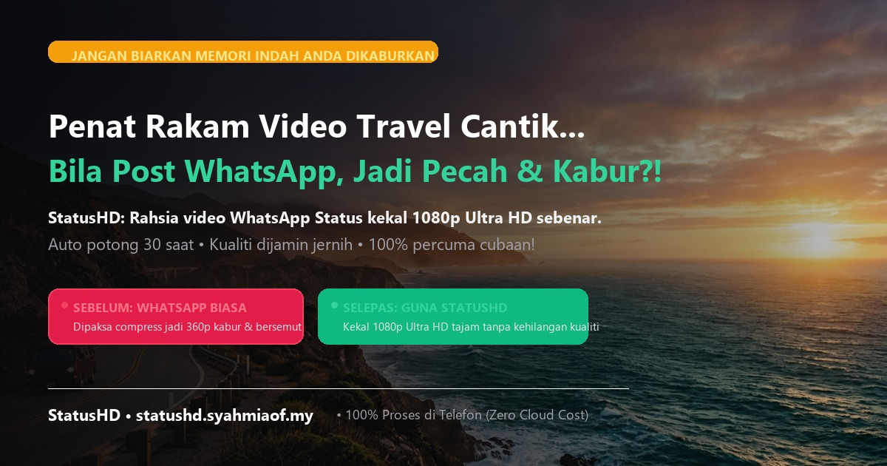

<div align="center">
  <h1>whatsapp-hd-status-pwa</h1>
  <p><strong>StatusHD — Privacy-First Client-Side WebAssembly Video Optimizer & Splitter for WhatsApp Status</strong></p>
  <p>
    <a href="https://statushd.syahmiaof.my/"></a>
    <a href="https://github.com/syahmiaof/whatsapp-hd-status-pwa"></a>
    <a href="https://github.com/syahmiaof/whatsapp-hd-status-pwa/actions"></a>
    <a href="LICENSE"></a>
  </p>
  <p>
    
    
    
    
    
    
  </p>
</div>

---



## 📌 Problem & Architectural Solution

When users upload high-resolution 4K or 60fps videos directly to WhatsApp Status, WhatsApp's servers apply aggressive, lossy recompression algorithms that introduce severe banding, blurriness, and frame drops. 

**StatusHD (whatsapp-hd-status-pwa)** solves this by pre-transcoding source videos on-device to WhatsApp's exact playback profile sweet spot and splitting long videos into contiguous 30.0-second segments. Because the resulting video perfectly matches WhatsApp's ingestion criteria, WhatsApp bypasses server-side recompression and serves the video in crisp, native HD quality.

---

## ⚙️ Client-Side WebAssembly Transcode Engine

This application performs 100% of its video processing inside the client browser using `@ffmpeg/ffmpeg` compiled to WebAssembly:

- **🔒 Zero Cloud Processing**: No video content or metadata is ever uploaded to a server. Processing runs strictly in local browser memory.
- **Optimized Video Pipeline**:
  - **Container**: MP4 with `-movflags +faststart` for instantaneous streaming.
  - **Codec**: H.264 (`libx264`), Profile High, Level 4.0.
  - **Framerate**: Standardized to 30.0 fps (prevents WhatsApp 60fps panic re-encoding).
  - **Resolution Target**: Dynamic scale to 1080×1920 (vertical 9:16) or 720×1280 based on device capability.
  - **Quality Tuning**: Constant Rate Factor (CRF 20–22) with `preset fast` for fast client-side performance.
  - **Audio Stream**: AAC, 128 kbps, 44.1 kHz stereo with optional mute.
  - **Automated Slicing**: Seamlessly splits extended clips into sequential 30-second story status segments ready for sequential posting.

---

## 🚀 Quick Start & Local Commands

```bash
# Install dependencies
npm ci

# Run development server
npm run dev

# Run TypeScript type validation
npm run typecheck

# Build production bundle with PWA service worker
npm run build

# Preview production build locally
npm run preview
```

### Video Smoke Test

To run the automated smoke test fixture against production preview:
```bash
# In one terminal, preview production build on 4173
npm run preview

# In another terminal:
npm run test:smoke
```

---

## 📱 Progressive Web App (PWA) Installation

- **iOS (Safari)**: Open the web app, tap the **Share** button, and choose **Add to Home Screen**.
- **Android (Chrome)**: Tap the in-app install prompt or select **Add to Home screen** from the menu.

The application registers an offline service worker via `vite-plugin-pwa`, enabling instant caching and offline transcoding capabilities.

---

## 📄 License

This repository is open-sourced under the [MIT License](LICENSE).  
Copyright © 2026 Muhammad Syahmi (syahmiaof).
